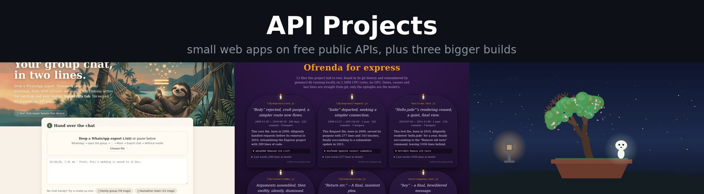
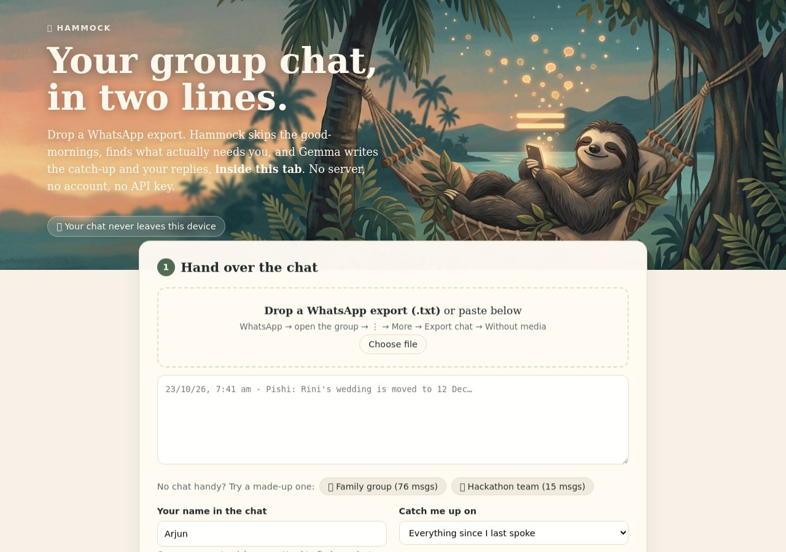
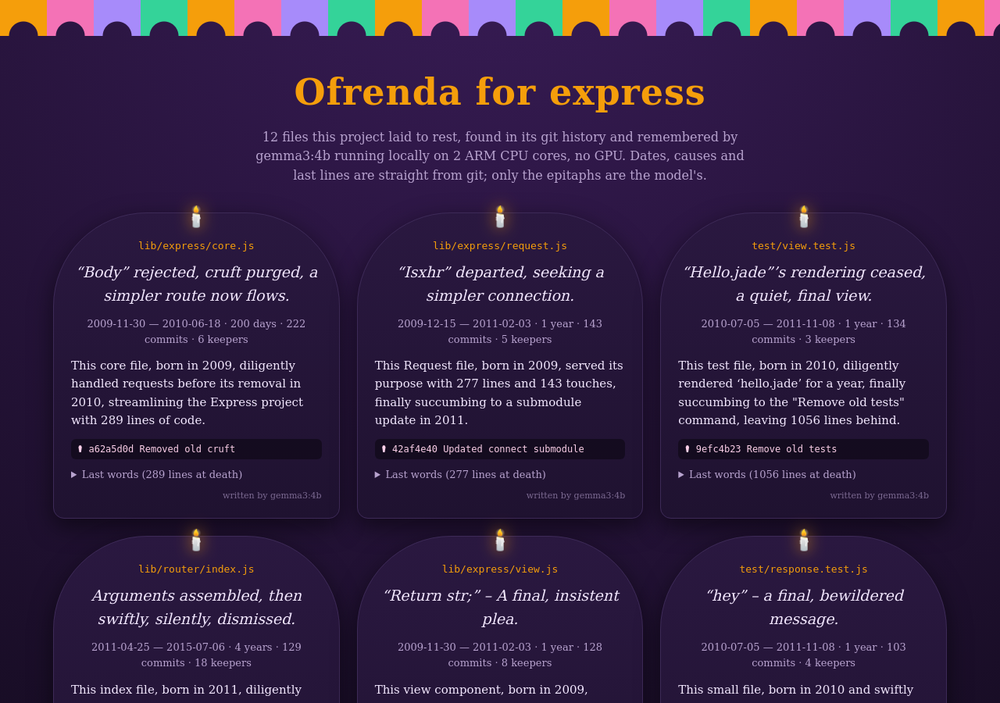
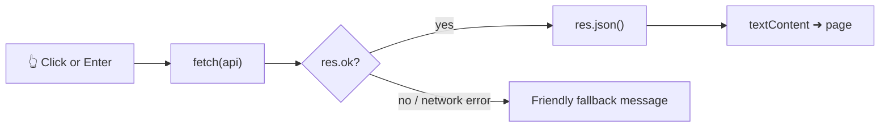

<div align="center">



# API Projects

**Small, readable JavaScript apps built on free public APIs, for practicing logic and `fetch`, plus three bigger builds that live in the same repo.**

[](https://github.com/aniruddhaadak80/API_projects/actions/workflows/ci.yml)
[](https://aniruddhaadak80.github.io/API_projects/)
[](LICENSE)


**[▶ Open the live site](https://aniruddhaadak80.github.io/API_projects/)** · [Projects](#-the-projects) · [Run locally](#-run-it-locally) · [How it works](#-how-the-small-apps-work) · [Contributing](CONTRIBUTING.md)

</div>

---

## ✨ The projects

### Small apps (one page each, no build step)

| | App | What it does | API | Try it |
|---|---|---|---|---|
| 📅 | **Leap year checker** | Type a year, get the Gregorian answer (press Enter or Submit) | none, pure logic | [Open](https://aniruddhaadak80.github.io/API_projects/#inputYear) |
| 💬 | **Random quotes** | A new quote and author every 9 s, or on demand | [DummyJSON](https://dummyjson.com/docs/quotes) | [Open](https://aniruddhaadak80.github.io/API_projects/) |
| 🔢 | **Number facts** | Prime? perfect? square, cube, Fibonacci, binary, hex, Roman numerals | none, computed in the page | [Open](https://aniruddhaadak80.github.io/API_projects/) |
| 😻 | **Cat facts** | One random cat fact per click | [catfact.ninja](https://catfact.ninja) | [Open](https://aniruddhaadak80.github.io/API_projects/) |
| 🥱 | **Bored?** | A random activity for one person | [Bored API](https://www.boredapi.com) | [Open](https://aniruddhaadak80.github.io/API_projects/) |
| 😂 | **Jokes** | Setup and punchline | [Official Joke API](https://github.com/15Dkatz/official_joke_api) | [Open](https://aniruddhaadak80.github.io/API_projects/jokes.html) |
| 🧠 | **Advice** | A random piece of advice | [Advice Slip](https://api.adviceslip.com) | [Open](https://aniruddhaadak80.github.io/API_projects/advice.html) |
| 🔳 | **QR code generator** | Type text or a URL, get a QR code | [goQR.me](https://goqr.me/api/) | [Open](https://aniruddhaadak80.github.io/API_projects/qrcode.html) |
| 🐶 | **Dog pics** | A random dog photo every 9 s | [Dog CEO](https://dog.ceo/dog-api/) | [Open](https://aniruddhaadak80.github.io/API_projects/dogImg.html) |
| 🎨 | **Random color** | Recolors the page, shows the hex and RGB | [x-colors](https://x-colors.yurace.pro) | [Open](https://aniruddhaadak80.github.io/API_projects/randomColor.html) |

### Bigger builds

| | Project | What it is | Stack | Links |
|---|---|---|---|---|
| 🦥 | **[Hammock](hammock/)** | Your WhatsApp group chat in two lines. Gemma summarizes it **inside the browser tab**, offline after the first visit. | Vanilla JS, WebGPU, service worker | [Live](https://aniruddhaadak80.github.io/API_projects/hammock/) · [Code](hammock/) |
| 🕯️ | **[git-ofrenda](git-ofrenda/)** | An altar for the files your repo deleted, with epitaphs from a local model. | Python stdlib, Ollama/llama.cpp | [Altar](https://aniruddhaadak80.github.io/API_projects/git-ofrenda/) · [Code](git-ofrenda/) |
| 🌱 | **[Kodama](kodama/)** | A desk bonsai spirit that grows when you breathe slowly and asks you to breathe with it when your pulse climbs. | Electron, Presage SmartSpectra SDK | [Code](kodama/) |

<details>
<summary><b>📸 Screenshots</b> (click to expand)</summary>

| Hammock | git-ofrenda | Kodama (UI preview, simulated signals) |
|---|---|---|
|  |  |  |

</details>

---

## 🚀 Run it locally

The small apps are plain HTML, CSS and JavaScript. Any static server works:

```bash
git clone https://github.com/aniruddhaadak80/API_projects.git
cd API_projects
npx serve .            # or: python3 -m http.server 8080
```

Then open <http://localhost:3000> (or <http://localhost:8080>).

<details>
<summary><b>🧪 Run the tests</b></summary>

```bash
npm test                                   # small apps: leap-year + number-fact logic (Node 20+)
npm run check:links                        # every local href/src resolves to a committed file
(cd hammock && npm test)                   # Hammock core
(cd kodama && npm test)                    # Kodama signal logic (no SDK or camera needed)
(cd git-ofrenda && python3 -m unittest -v) # git-ofrenda
```

CI runs all of these on every push and pull request.

</details>

---

## 🧭 How the small apps work

Every small app follows the same four-step pattern, which is the point of the repo:



<details>
<summary><b>See the code pattern</b></summary>

```js
const getFact = async () => {
  try {
    const res = await fetch("https://catfact.ninja/fact");
    if (!res.ok) throw new Error(`HTTP ${res.status}`);
    const { fact } = await res.json();
    output.textContent = fact;   // textContent, never innerHTML, for API data
  } catch (err) {
    output.textContent = "Couldn't load a cat fact right now. Try again in a moment.";
  }
};
button.addEventListener("click", getFact);
```

</details>

<details>
<summary><b>Good habits baked in</b></summary>

- **Safe rendering.** API responses go in with `textContent`, so a hostile response can't inject HTML.
- **Graceful failure.** Every request checks `res.ok` and catches network errors.
- **Polite polling.** Timers pause while the tab is hidden, and the nav color refresh runs every 2 s, not 500 ms.
- **Logic first.** Leap year and number facts are pure functions with unit tests, no network needed.
- **Pinned CDN assets.** Bootstrap loads with Subresource Integrity hashes.

</details>

<details>
<summary><b>🔧 APIs that changed</b></summary>

| Old API | What happened | Now |
|---|---|---|
| `api.quotable.io` | Certificate expired, site offline | DummyJSON quotes |
| `numbersapi.com` | No HTTPS, returns 404 | Facts computed locally in `number.js` |
| `random.dog` | Sometimes returns `.mp4`/`.webm`, which `` can't show | Dog CEO (always JPEG) |

</details>

---

## 📁 Repository layout

```text
.
├── index.html            # home: leap year, quotes, number facts, cat facts, bored
├── jokes.html  advice.html  qrcode.html  dogImg.html  randomColor.html
├── *.js  *.css           # one script per app
├── test/                 # node:test unit tests for the pure logic
├── hammock/              # 🦥 in-browser Gemma chat summarizer
├── git-ofrenda/          # 🕯️ git-history altar
├── kodama/               # 🌱 SmartSpectra desk companion (Electron)
└── .github/              # CI, Dependabot, issue and PR templates
```

## 🤝 Contributing

Issues and pull requests are welcome. Start with [CONTRIBUTING.md](CONTRIBUTING.md), and please follow the [Code of Conduct](CODE_OF_CONDUCT.md). Found a security problem? Report it privately as described in [SECURITY.md](SECURITY.md).

## 📜 License

[MIT](LICENSE) © 2026 Aniruddha Adak. The bigger builds carry their own licenses and third-party credits in their folders.

<div align="center">

Made by [@aniruddhaadak80](https://github.com/aniruddhaadak80) · ⭐ Star the repo if one of these helped you learn something.

</div>
