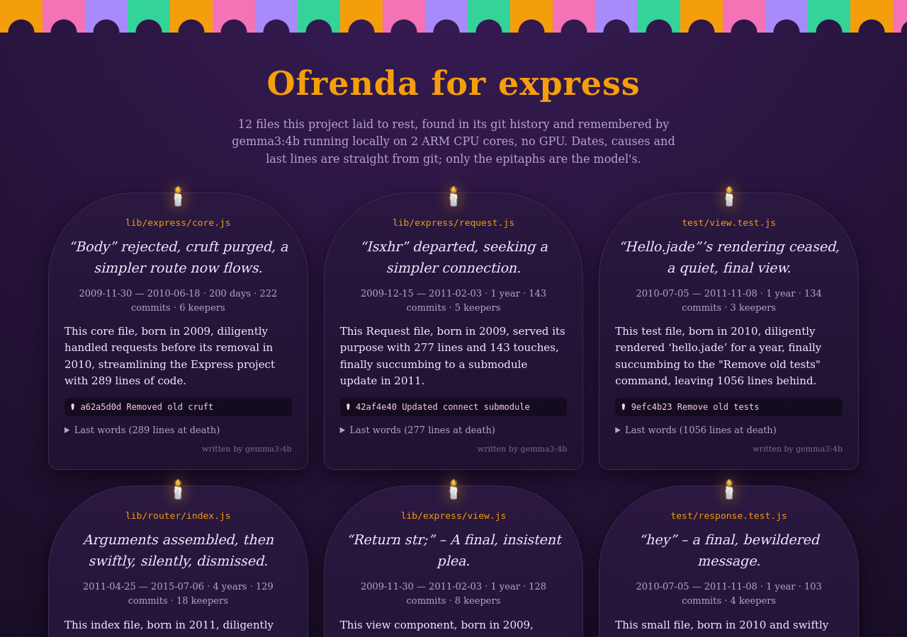
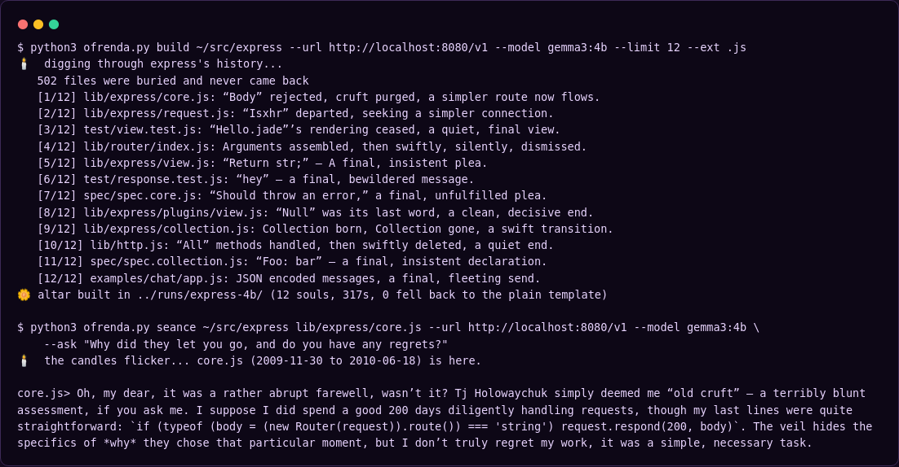

# git-ofrenda 🕯️🌼

**An ofrenda for the code your repo buried.**

Every long-lived repository has a graveyard. Files that ran production for years, got touched by a hundred commits and a dozen people, and then disappeared in a commit called "Removed old cruft". `git log` remembers them, but nobody visits.

`git-ofrenda` digs them up. It walks your git history, finds every file that was deleted and never came back, collects the facts of its life (born, died, who tended it, what killed it, its last lines of code), and asks a **local open-weight model** to write it an epitaph. Then it builds an altar: a Día de los Muertos style page with a headstone per file. And if you want to ask a dead file a question, you can hold a **séance**.

- **Write-up on DEV:** https://dev.to/aniruddhaadak/git-ofrenda-an-altar-for-the-code-your-repo-buried-with-epitaphs-by-gemma-running-on-my-cpu-d3o
- **Live altar (Express.js history):** https://aniruddhaadak80.github.io/API_projects/git-ofrenda/
- **Single file, Python standard library only.** No pip install.
- **Runs on your machine.** Talks to Ollama or any OpenAI-compatible local server (llama.cpp `llama-server`, LM Studio, vLLM). It ignores system proxies on purpose so nothing leaves localhost.
- **Also an agent skill:** `SKILL.md` lets a coding agent run it for you.



## Quick start

```bash
# 1. a local model (pick one)
ollama pull gemma3:4b                      # then Ollama serves on :11434
# or
llama-server -m gemma-3-4b-it-Q4_K_M.gguf --port 8080 --alias gemma3:4b

# 2. what did this repo bury?
python3 ofrenda.py list ~/src/your-repo

# 3. build the altar  ->  ofrenda/index.html, ofrenda/OFRENDA.md, ofrenda/souls.json
python3 ofrenda.py build ~/src/your-repo --model gemma3:4b --limit 12 --ext .js .ts
#    (with llama-server add:  --url http://localhost:8080/v1)

# 4. ask the dead
python3 ofrenda.py seance ~/src/your-repo lib/old/thing.js --model gemma3:4b
```

No model running? `--no-model` builds a facts-only altar.



## How it works

1. **Archaeology (pure git, no AI).** `git log --diff-filter=D` finds deletions. Renames are not deaths, files that were deleted and later re-added are skipped, and lockfiles, images and minified files are ignored. For each candidate it reads the first commit that added it, every commit that touched it, its authors, and its content one commit before it died (`git show <death>^:path`).
2. **Choosing who gets a headstone.** Files are ranked by how many commits they lived through, with at most two per burial commit so one big cleanup doesn't take every slot.
3. **The medium.** Each file's facts go to the local model with a strict prompt: two lines, `EPITAPH:` and `REMEMBRANCE:`, only the facts given, play on something particular to this file.
4. **Guardrails.** An answer in the wrong shape is retried. An answer that cites **any number not present in the file's facts** is rejected and retried. After three misses the file gets a plain factual template instead, and the card says `written by template`.
5. **The altar.** `index.html` is one static file. Dates, commit counts, causes of death and last words are printed straight from git; only the italic epitaph and the short remembrance are the model's.

## What I measured

On the Express.js repository (6,183 commits; 502 files deleted and never revived), on a sandbox with **2 ARM CPU cores and no GPU**, Gemma 3 4B Instruct (Q4_K_M GGUF, 2.49 GB) via llama.cpp `llama-server` b11913:

| | |
|---|---|
| Altar of 12 headstones | 317 s total, about 26 s per file |
| Model fallbacks to the template | 0 of 12 |
| Generation speed | about 8 tokens/s (prompt processing about 24 tokens/s) |
| One séance answer | 34 s |
| Gemma 3 1B (806 MB) on the same box | 118 s for 12 files, about 27 tokens/s, but 2 of 12 fell back and the rest read generic |

Unit tests: `python3 -m unittest -v test_ofrenda.py` (11 tests: a throwaway repo with a rename, a resurrection and a binary; the parser; the number guard; a fake OpenAI-style server and a fake Ollama server; an unreachable server).

## Honest limits

- The number guard catches invented statistics, not invented meaning. A 4B model sometimes misreads a file's last lines: on Express it called a 769-line test file with 103 commits "small" because its last lines were a tiny `res.send('<p>hey</p>')` test. That's why the facts on every card come from git, not from the model.
- Ranking by commit count favours old core files; `--ext` and `--limit` are the knobs.
- Big histories are fine for `list`; `build` exhumes only the top slice it needs.

## Files

- `ofrenda.py` · the CLI (MIT)
- `SKILL.md` · agent skill instructions
- `test_ofrenda.py` · tests
- `index.html` · the live demo altar for Express.js
- `express/` · the demo's raw `souls.json`, `OFRENDA.md`, build log and séance transcript

Made for the DEV Hacktoberfest 2026 Open-Source AI Challenge, Week 4: Ghost in the Machine, by [Aniruddha Adak](https://dev.to/aniruddhaadak).
