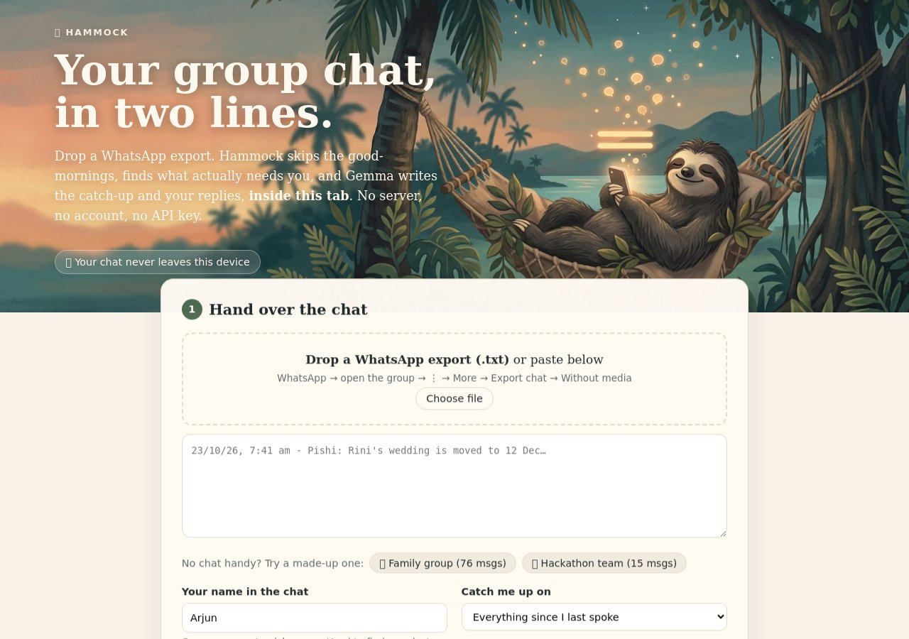
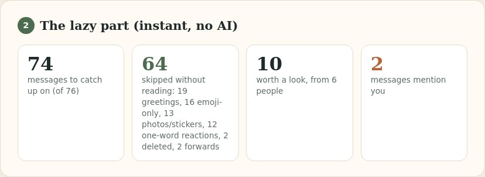
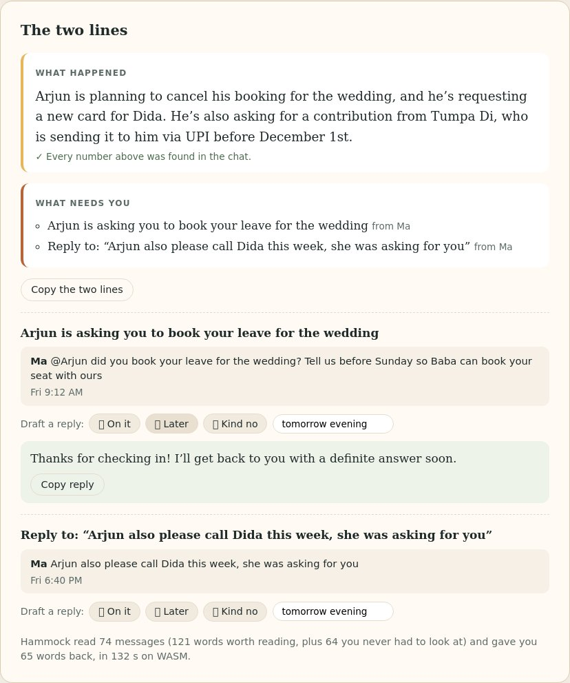

# 🦥 Hammock

**Your group chat, in two lines.** Drop a WhatsApp export and lie back: Hammock skips the good-mornings, finds the messages that actually need you, and Gemma writes the catch-up and your replies **inside your browser tab**. No server, no account, no API key. After the first visit it works with the Wi-Fi off.

**DEV write-up:** https://dev.to/aniruddhaadak/hammock-my-group-chat-in-two-lines-read-by-gemma-inside-a-browser-tab-c31

**Live demo:** https://aniruddhaadak80.github.io/API_projects/hammock/ (Chrome or Edge with WebGPU for the good model)




Built for the [DEV Hacktoberfest Open-Source AI Challenge, Week 3: Slow and Steady](https://dev.to/challenges/hacktoberfest-week3-2026-10-19).

## What it does

1. **Hand over the chat.** WhatsApp → open the group → ⋮ → More → Export chat → Without media. Drop the `.txt` (Android and iOS formats, 12h and 24h clocks, day-first and month-first dates). Or paste any `Name: message` lines. Two made-up sample chats are built in.
2. **The lazy part, instantly, no AI.** It finds your last message and only looks at what came after. Greetings, forwards, stickers, emoji-only lines, "very nice 👍" and deleted messages are skipped and counted. Messages that mention your name or nickname are pulled out.
3. **Gemma reads the rest.** Line one is what happened, written by Gemma. Line two is what needs you: found by code, phrased by Gemma as a to-do. Every number in the summary is checked against the chat and flagged if Gemma made it up.
4. **Reply without thinking.** Each "needs you" message gets three one-tap drafts: 👍 On it, ⏳ Later (you pick when), 🙅 Kind no. Copy and paste into WhatsApp.

## Screenshots

The deterministic part (instant, no model) on the made-up family chat:



A full run on the **CPU fallback** (headless Chromium, no GPU, 8-bit Gemma 3 1B, 132 s). Line one gets *who* wrong ("Arjun is planning to cancel..." is not what happened); that is exactly why the "needs you" list is found by code, not by the model. The second to-do is the excerpt fallback, used when the model's to-do is rejected.



## Models

| Mode | Model | Download | Runs on |
|---|---|---|---|
| Nap (default) | [Gemma 3 1B IT](https://huggingface.co/onnx-community/gemma-3-1b-it-ONNX), 4-bit | ~0.8 GB | WebGPU (q4f16, or q4 when the GPU has no fp16) |
| Nap, CPU fallback | Gemma 3 1B IT, 8-bit (`model_uint8.onnx`) | ~1 GB | WASM, when there is no WebGPU. About 2 minutes for the family sample on a 2-vCPU sandbox, and rough: the summary often needs a retry. |
| Deep sleep | [Gemma 4 E2B IT](https://huggingface.co/onnx-community/gemma-4-E2B-it-ONNX), 4-bit | ~3 GB | WebGPU only |

Weights come from the Hugging Face Hub once and are cached by the browser. Inference runs with [Transformers.js](https://huggingface.co/docs/transformers.js) on ONNX Runtime Web inside a Web Worker.

## How it is built

```
index.html        one page, no build step
src/core.js       parser, noise filter, "since you last spoke" window, mention finder,
                  prompts, output cleaners, number check  (pure functions, no DOM)
src/app.js        UI + worker plumbing
src/worker.js     the only file that touches a model (Transformers.js, WebGPU/WASM)
sw.js             service worker so the app opens offline after the first visit
samples/          two fictional chats
test/             node --test unit tests for core.js
docs/eval.md      what I measured, including where the 1B model gets it wrong
```

Design rule: **code decides, Gemma writes.** Anything that has to be right (who mentioned you, what you can skip, whether a number is real) is deterministic and tested. Gemma does what small open models are genuinely good at: compressing a messy thread into plain language and drafting a short reply.

## Run it locally

```bash
git clone https://github.com/aniruddhaadak80/API_projects.git
cd API_projects/hammock
python3 -m http.server 8080     # any static server works
# open http://localhost:8080
npm test                        # 14 unit tests for the parser / filter / output checks
```

## Privacy

Your chat is read with `FileReader` and never sent anywhere. The only network requests are GETs for the app's own files, Transformers.js from jsDelivr, and the model weights from Hugging Face. You can check in DevTools → Network, or switch the Wi-Fi off after the first run.

## Limits

- Small models get *who did what* wrong sometimes (see `docs/eval.md`). Read the line, it is two lines.
- The CPU fallback uses an 8-bit export because ONNX Runtime Web's WASM backend lacks the 4-bit `GatherBlockQuantized` op (the 270M model's 8-bit export uses it too, I tried). It is slow, and its first summary attempt often comes back empty, so Hammock retries on the last 8 messages and, if that also fails, says so and shows the latest message instead.
- Model to-dos that echo the instructions or ramble are rejected and replaced with a plain excerpt of the message.
- Media, voice notes and polls are skipped, not transcribed.
- Name detection is a word match on the names you type, so add nicknames.

## License

MIT © 2026 Aniruddha Adak. Gemma is provided under the [Gemma terms](https://ai.google.dev/gemma/terms) (Gemma 3) and Apache 2.0 (Gemma 4).
