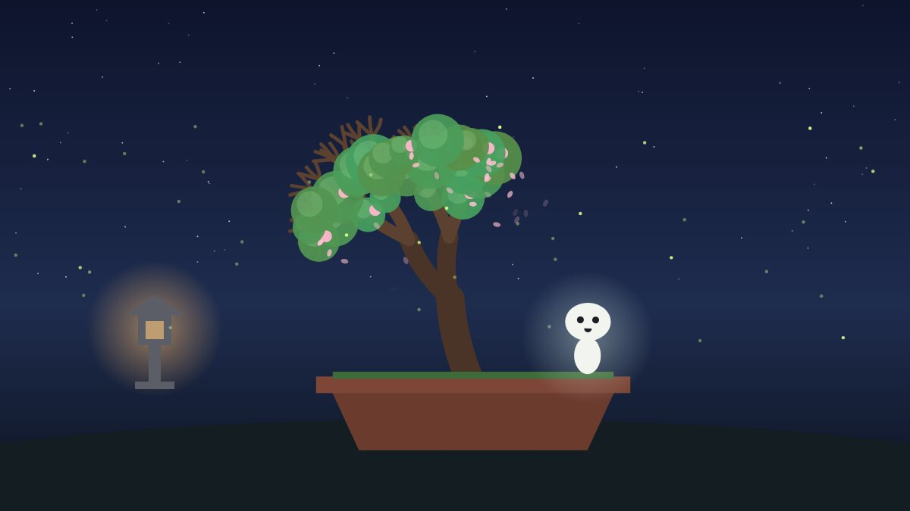

# Kodama 🌱

A tiny tree spirit that lives on your desk and breathes with you.



Kodama watches your webcam through the [Presage SmartSpectra SDK](https://smartspectra.presagetech.com/docs) and turns live human signals into a little world:

| Signal (SmartSpectra) | What Kodama does |
|---|---|
| Breathing rate | Slow, steady breathing grows new leaves on the bonsai. |
| Upper-chest breathing trace | Kodama's belly and the leaves rise and fall with *your* chest, in real time. |
| Pulse rate | The stone lantern glows on every heartbeat. Pulse is compared only with *your own* first minute. |
| Pulse well above your calm + fast breathing for a minute | Kodama gets restless, the sky turns hazy, and it asks you to breathe with it. |
| Guided round (4 s in, 6 s out) | A blue orb paces you; a white ring drawn from your live chest trace shows how closely you follow. |
| Happy expression | The bonsai blossoms and drops petals. |
| Blinks | Kodama blinks with you. |
| Talking | Kodama tilts its head and listens; growth pauses (breathing readings aren't reliable while talking). |
| Validation hints (lighting, framing) | Kodama tells you in a speech bubble. |

It is a wellness toy, **not a medical device**. It never diagnoses anything and never compares you with a population "normal".

## Run it

Needs Node 20+, a webcam, and a free Presage API key from <https://physiology.presagetech.com/auth/register>.
SmartSpectra's Node runtime supports macOS (Apple Silicon), Windows x64 and Linux x64/arm64 (glibc 2.35+).

```bash
git clone https://github.com/aniruddhaadak80/API_projects.git
cd API_projects/kodama
npm install
SMARTSPECTRA_API_KEY=your_key npm start      # or leave it unset and paste the key on the consent screen
```

On Windows PowerShell: `$env:SMARTSPECTRA_API_KEY="your_key"; npm start`.

Replay a video instead of the webcam: `npm run start:file -- path/to/clip.mp4`.

For good readings: sit still, face and upper chest visible, even light, no flickering screens behind you. Breathing rate needs about 30 seconds to appear, HRV about 60.

## Consent and data handling

- **Consent first.** The camera is not touched until you read the consent screen, tick "I understand" and press Start. Electron is set to grant only the camera (never the microphone), and only to Kodama's own local page.
- **Nothing stored.** No video, frames or readings are written to disk or sent anywhere by Kodama. State lives in memory and disappears when you press Stop or close the window.
- **Presage.** The SDK authenticates with Presage using your API key. Its aggregate diagnostics (no video, no measured values, no identifiers, per [Presage's telemetry docs](https://smartspectra.presagetech.com/docs/telemetry-and-privacy)) are **off by default** (`enableTelemetry: false`) and only turn on if you tick the box.
- **API key.** Read from your environment or typed into the consent screen; kept in memory only.
- **No AI services.** Kodama does not call any LLM or other AI service.

## How it's built

```
main.js                Electron main: binds SmartSpectra IPC, camera-only permission
renderer.js            consent screen, SDK session, paint loop (bundled by esbuild)
src/brain.js           signals → mood: personal baseline, calm score, growth, nudges, pacer
src/scene.js           Canvas 2D world: bonsai, lantern, fireflies, Kodama, guide orb, HUD
tools/record-session.mjs  run a clip through the real SDK headlessly, save the signals
tools/render-demo.mjs     replay a saved session through the same brain + scene into an MP4
test/brain.test.js     unit tests for the signal logic (npm test)
```

The demo video was made with `tools/record-session.mjs` (real SDK, telemetry off) on a stock clip from Pexels, *"Video of a Man Meditating"* by Katrin Bolovtsova (Pexels License), played forward then backward to reach the 30 s the breathing model needs. Then `tools/render-demo.mjs` replayed those signals through the app's own `Brain` and `Scene`.

## Credits

- Presage SmartSpectra SDK (`@smartspectra/node-sdk`), and its Electron quickstart, which `main.js` follows.
- Stock footage: Katrin Bolovtsova on Pexels.

MIT licensed.
